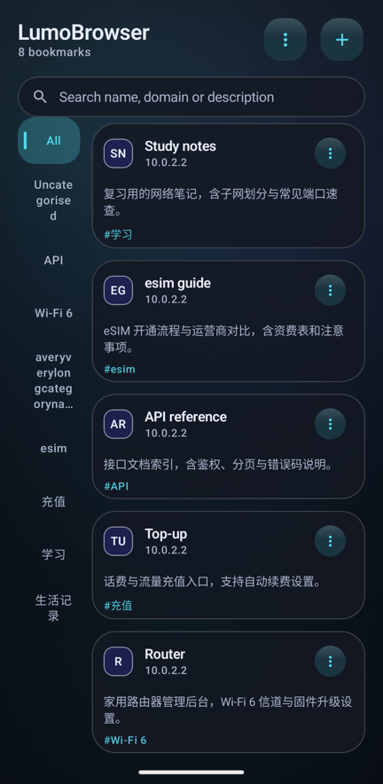
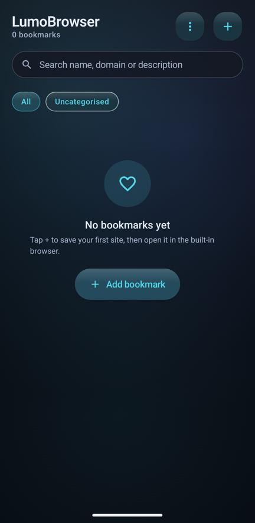

# LumoBrowser

一个不打算上应用商店的 Android 浏览器。用 Kotlin + Jetpack Compose 从零写一个 WebView 外壳，把「收藏」当作一等公民，其余部分（广告屏蔽、无障碍辅助、网络状态解释、音效与动效）按自己的需要长出来。

面向 Android 8.0（API 26）及以上，包名 `com.lumobrowser.app`。

<p align="center">
  
  
</p>

> 上面是 1.09 的两种分类栏排布（左：`Left`；右：默认 `Top`），在 1080 × 2340 / 411 dp 的模拟器上截取。同目录下的 `v109-left-rail-REJECTED.png` 是按窗口宽度 26% 计算栏宽、把卡片挤窄之后**被否掉的**第一版——留档是为了让「为什么后来改成固定 64 dp」有据可查。

---

## 这是什么

| | |
| --- | --- |
| 当前版本 | **1.09**（`versionCode` 11） |
| 技术栈 | Kotlin 1.9.24 · Jetpack Compose（Material 3）· Room · DataStore · AndroidX WebKit |
| 架构 | 单 Activity + MVVM：`ViewModel` + `StateFlow`，无 DI 框架 |
| 构建 | AGP 8.4.2 · Gradle 8.6（wrapper 随仓库提供）· JDK 17 · `compileSdk 34` / `minSdk 26` |
| 代码量 | `app/src` 下 126 个 Kotlin 文件（含测试） |
| 界面语言 | 简体中文 / 繁體中文 / English，设置里即时切换，无需重启 |

## 功能

- **收藏**：分类、搜索、卡片/列表两种布局，分类栏可放**顶部或左侧**；数据存 Room，带完整性校验与迁移。
- **内置浏览器**：AUTO / 手机版 / 桌面版 / 兼容模式四种浏览模式，**每个网址**可独立配置 UA、JavaScript、DOM 存储、第三方 Cookie；文件选择、权限请求、下载、渲染进程崩溃恢复都接了实际处理。
- **广告屏蔽**：随包内置规则文件，主机 + 子域匹配，可站点级暂停；被丢弃的规则会在设置页列出，而不是静默忽略。
- **无障碍辅助服务**：可选开启，只做「替用户按一次他指定的那个按钮」这一件事，权限与行为逐条写在 [`docs/ACCESSIBILITY_ASSIST.md`](docs/ACCESSIBILITY_ASSIST.md)。
- **反馈系统**：19 种事件 × 4 种音效风格，全部**运行时程序化合成**（`AudioTrack` + ADSR 包络），APK 内不含任何音频素材；触觉强度可调，并跟随系统「减弱动效」。
- **导航安全 / 外部跳转策略**：站内、站外、外部 App 三类跳转各有明确策略与确认面板，见 [`docs/NAVIGATION_SECURITY.md`](docs/NAVIGATION_SECURITY.md)、[`docs/EXTERNAL_BROWSER_POLICY.md`](docs/EXTERNAL_BROWSER_POLICY.md)。
- **崩溃不再静默**：崩溃自述页 + 安全模式启动，见 [`docs/CRASH_RECOVERY.md`](docs/CRASH_RECOVERY.md)。

## 安装

从本仓库的 **Releases** 页面下载 APK。发布说明里会列出每个包的大小与 SHA-256。

| 包 | 包名 | 说明 |
| --- | --- | --- |
| `LumoBrowser-v1.09-debug.apk` | `com.lumobrowser.app.debug` | Debug 签名，**可与正式包共存**，便于对照测试 |
| `LumoBrowser-v1.09-release.apk` | `com.lumobrowser.app` | 已签名、不可调试。部分 ROM 会拦截 debuggable 的侧载应用，那种情况下装这个 |

<details>
<summary>装上了却打不开 / 覆盖安装失败怎么办</summary>

1. **先卸载再装。** 签名冲突的报错长得像「解析包时出现问题」，但根因是签名不一致。
2. 抓不到崩溃栈时看应用自己的记录：设置页 → 关于 → 崩溃记录（1.07 起崩溃不再静默）。
3. `adb devices -l` 里没有设备，是数据线 / 驱动 / 授权问题，不是应用问题；状态是 `unauthorized` 时在手机上点「允许 USB 调试」。
4. 逐条排除记录见 [`docs/DELIVERY-HISTORY-1.0-1.08.md`](docs/DELIVERY-HISTORY-1.0-1.08.md) §14。
</details>

## 从源码构建

```bash
# 1. 指向自己的 SDK（这个文件不会进版本库）
#    Windows 写法：sdk.dir=D\:\\AndroidDev\\sdk
echo 'sdk.dir=/path/to/Android/Sdk' > local.properties

# 2. Debug 包
./gradlew :app:assembleDebug          # Windows 用 .\gradlew.bat

# 3. 单元测试
./gradlew :app:testDebugUnitTest
```

需要 **JDK 17** 与 **Android SDK Platform 34 + Build-Tools 34.0.0**。Gradle 由 wrapper 自行下载（首次需要网络；离线环境改用本机 Gradle，见 [`docs/BUILD.md`](docs/BUILD.md) §7 排障表）。

> **首次跑测试会下载约 150 MB 的 Robolectric 运行时 jar**（`android-all-instrumented`）。如果这台机器无法完成 TLS 证书吊销检查、下载会挂死，可以预先手工放好 jar 并让构建走本地解析——步骤与原理见 [`docs/BUILD.md`](docs/BUILD.md) §4。

### Release 签名

仓库**不包含**任何签名密钥（`.gitignore` 忽略 `*.jks` / `*.keystore` / `keystore/keystore.properties`）。没有密钥也能构建，release 变体只是产出**未签名**包——签名从来不是构建的前提。

要产出可安装的 release 包，用你自己的密钥：

```bash
keytool -genkeypair -v -keystore keystore/my-release.jks -storetype PKCS12 \
  -alias mykey -keyalg RSA -keysize 2048 -validity 10950 \
  -dname "CN=Your Name, O=Your Org, C=CN"
```

再创建 `keystore/keystore.properties`（同样不会被提交）：

```properties
storeFile=keystore/my-release.jks
storePassword=……
keyAlias=mykey
keyPassword=……
```

`app/build.gradle.kts` 已经接好这份配置的读取逻辑，细节见 [`docs/BUILD.md`](docs/BUILD.md) §6。**注意**：换成自己的密钥后签名与任何既有安装包不同，`applicationId` 相同的包必须先卸载旧版。

## 文档

这个项目把「为什么这么写」看得和「写了什么」一样重，所以文档比一般仓库厚：

| 文档 | 内容 |
| --- | --- |
| [`CHANGELOG.md`](CHANGELOG.md) | **每个交付版本改了什么、为什么改**，最新版本在最上面 |
| [`docs/`](docs/) | 24 篇专题文档：构建、测试、书签布局、浏览器模式、广告屏蔽、音效、动画、启动优化、VPN 说明、无障碍辅助、崩溃恢复…… |
| [`docs/TESTING.md`](docs/TESTING.md) | 测试策略与逐条验证记录（含失败与返工的原文） |
| [`docs/build-logs/`](docs/build-logs/) | 各版本原始 Gradle 构建日志，**包含失败的那几次** |
| [`docs/DELIVERY-HISTORY-1.0-1.08.md`](docs/DELIVERY-HISTORY-1.0-1.08.md) | 从 1.0.0 到 1.08 的交付记录原文：真机事故、缺陷根因、被否掉的第一版实现、每轮「没有验证什么」 |

几篇值得先看的：

- [`docs/BUILD.md`](docs/BUILD.md) —— 环境、命令行构建、离线测试、签名、排障、历史构建结果
- [`docs/AD_BLOCKING.md`](docs/AD_BLOCKING.md) —— 规则格式、匹配范围，以及为什么某些修饰符选择「丢弃并报告」而不是「忽略」
- [`docs/BOOKMARK_LAYOUT.md`](docs/BOOKMARK_LAYOUT.md) —— 分类栏两种排布与配色依据
- [`docs/WEBVIEW_HISTORY_RESTORE.md`](docs/WEBVIEW_HISTORY_RESTORE.md) —— 返回键为什么要读 WebView 自己的历史

## 这份源码验证到什么程度

发布到本仓库的这棵树，是在**本机重新跑过**的，不是「写完就传」：

| 项目 | 结果 |
| --- | --- |
| `:app:testDebugUnitTest` | ✅ **729 例 / 45 个类，0 失败 0 错误 0 跳过** |
| 编译告警 | ✅ 0 个 `w:`、0 个 `e:` |
| 与已发布源码包的一致性 | ✅ 299 个文件逐个 SHA-256 比对，**只有一个文件不同**（来源见下） |
| 真机 / 模拟器 | ❌ **没有**。`adb devices` 为空、SDK 里没有系统镜像 |

**比起上一版改了什么**：清理了一处死参数——`ui/HomeScreen.kt` 里 `LazyGridScope.bookContentItems` 的 `categories` 形参与它的两个调用点（1.09 的分类栏改版之后它已无人读取）。这是这棵树与已发布的 `LumoBrowser-v1.09-source.zip` **唯一**的差别；它消掉了那次构建里唯一一条 Kotlin 警告。

**没有验证什么**（不要把这行读成「已通过」）：真机上的启动、卡顿、震动模式下的音效、网页视频与全屏、真实站点上的广告误拦、无障碍辅助服务的节点树遍历——都需要真机或真实网络，逐条列在 [`docs/TESTING.md`](docs/TESTING.md) 里并标注为未测试。

## 数据与隐私

- 收藏、历史、设置全部**只存在本机**（Room + DataStore）。没有账号、没有同步、没有分析 SDK、没有网络上传。
- 内置的 VPN 相关代码只做**网络状态解释与跳转**，不含隧道实现，不会建立连接，见 [`docs/VPN_INTEGRATION.md`](docs/VPN_INTEGRATION.md)。
- 应用权限、无障碍辅助服务的用途与边界逐条写在文档里；辅助服务需手动开启，随时可关。

## 许可

[MIT](LICENSE)。

## 声明

这是一个个人侧载用的项目：没有上架计划，也没有在大量机型上验证过。截图里的界面、文案与配色都是自用的结果，不是设计规范。欢迎读代码和文档，也欢迎提 issue；但不承诺响应时间，也不接受「顺便加个功能」的请求。
